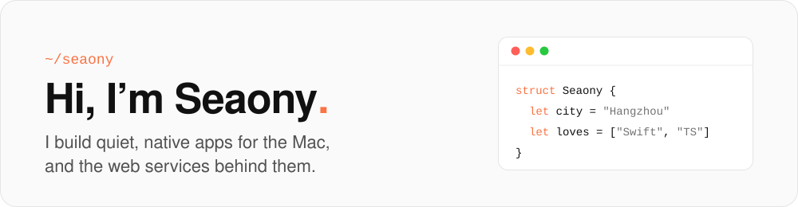

  <picture>
    <source media="(prefers-color-scheme: dark)" srcset="./assets/header-dark.svg" />
    
  </picture>

 

I'm a full-stack developer from Hangzhou, China 🇨🇳

**About me**

- 🍎 Building native macOS apps with Swift & SwiftUI: [Yomi](https://github.com/Seaony/Yomi) · [Moni](https://github.com/Seaony/Moni) · [Momento](https://github.com/Seaony/Momento)

- 🧰 On the web side: TypeScript, React, Next.js and Node.js; started out with PHP & Laravel

- 🚇 Made [china-city-subway](https://github.com/Seaony/china-city-subway), a metro database for every Chinese city with a subway

- 💬 Ask me anything [here](https://github.com/Seaony/Seaony/issues)

<code></code>
<code></code>
<code></code>
<code></code>
<code></code>
<code></code>
<code></code>
<code></code>

| <picture><source media="(prefers-color-scheme: dark)" srcset="./profile/stats-dark.svg" /></picture> | <picture><source media="(prefers-color-scheme: dark)" srcset="./profile/top-langs-dark.svg" /></picture> |
| ------------- | ------------- |

#### Top Repositories

<a href="https://github.com/Seaony/Yomi"><picture><source media="(prefers-color-scheme: dark)" srcset="./profile/pin-yomi-dark.svg" /></picture></a>
<a href="https://github.com/Seaony/Momento"><picture><source media="(prefers-color-scheme: dark)" srcset="./profile/pin-momento-dark.svg" /></picture></a>
<a href="https://github.com/Seaony/Moni"><picture><source media="(prefers-color-scheme: dark)" srcset="./profile/pin-moni-dark.svg" /></picture></a>
<a href="https://github.com/Seaony/china-city-subway"><picture><source media="(prefers-color-scheme: dark)" srcset="./profile/pin-china-city-subway-dark.svg" /></picture></a>
